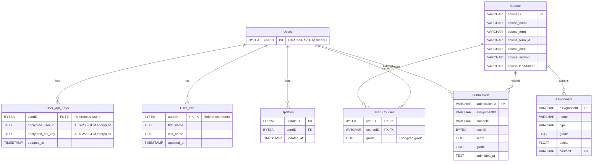

# Axiom

> **Academic Intelligence & Course Optimization Platform**  
> An intelligent university workflow engine integrating directly with Canvas LMS to analyze student standings, project GPAs, rank high-impact assignments, and visualize coursework through an interactive 2D physics engine.

---

## Table of Contents

- [Project Overview](#project-overview)
- [System Architecture](#system-architecture)
- [Key Attributes & Features](#key-attributes--features)
- [Current Project Status (Done vs. In Progress)](#current-project-status-done-vs-in-progress)
- [Prerequisites](#prerequisites)
- [Environment Variables (.env.example)](#environment-variables-envexample)
- [Step-by-Step Installation Guide (Teacher / Evaluator Friendly)](#step-by-step-installation-guide-teacher--evaluator-friendly)
- [How to Test the Application](#how-to-test-the-application)
- [Database Schema Reference](#database-schema-reference)
- [Backend API Endpoints](#backend-api-endpoints)
- [Troubleshooting & FAQ](#troubleshooting--faq)

---

## Project Overview

Axiom is engineered to solve a common dilemma university students face: managing competing coursework deadlines without clear insight into which assignments disproportionately affect their final grades and overall GPA.

Rather than treating every task as an identical checklist item, Axiom connects to Canvas LMS, ingests syllabi and grading weight distributions, and computes:
1. **Assignment Priority Index**: Identifies which impending tasks have the highest leverage over your course grade ($$\text{Urgency} \times \text{Weight \%}$$).
2. **Projected GPA Simulation**: Calculates estimated cumulative and semester GPAs based on current in-progress grades and remaining coursework weight.
3. **Interactive Physics Graph**: A 2D simulation canvas representing courses and assignments as weighted physical nodes governed by credit hours, assignment points, and grade standing.

---

## System Architecture

The project is structured as a monorepo containing two decoupled applications:

```
Axiom-new/
├── apps/
│   ├── api/
│   │   └── backend/               # Express 5 + TypeScript REST API
│   │       ├── cpp_engine/        # C++ Native Node addon (N-API / node-gyp)
│   │       ├── src/
│   │       │   ├── client/        # Canvas REST API & Mock Client
│   │       │   ├── crypto/        # AES-256-GCM & HMAC-SHA256 security layer
│   │       │   ├── mapper/        # Data sanitization & relational mapping
│   │       │   ├── routes/        # Express route controllers
│   │       │   ├── services/      # Database (PostgreSQL) & business logic
│   │       │   └── server.ts      # Server bootstrap & table initializer
│   │       ├── binding.gyp        # Native C++ addon build configuration
│   │       └── .env.example       # Backend environment template
│   └── web/                       # Next.js 16 + React 19 Frontend
│       ├── app/
│       │   ├── site/dashboard/    # Main academic dashboard view
│       │   ├── mocksite/          # Physics visualization & sandbox demo
│       │   └── page.tsx           # Authentication & verification gateway
│       ├── components/            # UI components (Shadcn + Tailwind v4)
│       └── lib/                   # Utility helpers
├── LICENSE
└── README.md
```

### Core Technologies
- **Frontend**: Next.js 16 (App Router), React 19, Tailwind CSS v4, Hugeicons, Recharts, HTML5 Canvas 2D Physics Engine.
- **Backend**: Express 5, TypeScript (`tsx`), PostgreSQL (`pg` connection pool), `node-addon-api` (C++ bindings).
- **Security**: Authenticated AES-256-GCM encryption for stored user credentials, HMAC-SHA256 for blinded database indexing.

---

## Key Attributes & Features

1. **Canvas LMS Live Integration**:
   - Communicates with Canvas REST API endpoints (`/api/v1/users/self`, `/api/v1/courses`, assignments, and submissions).
   - Employs a 20-minute update cache threshold (`lastUpdated`) to prevent rate-limiting and unnecessary external requests.

2. **Built-in Mock Client & Evaluator Sandbox**:
   - Includes a full `MockCanvasClient` simulating real student data (e.g. UNC Charlotte courses like ITCS-3160 Database Design and ITCS-3145 Parallel Computing).
   - Allows instant demonstration without requiring a personal Canvas API token.

3. **Zero-Knowledge Security Architecture**:
   - User tokens and personal identifiers are never stored in plaintext.
   - Encrypted with AES-256-GCM using unique random IVs and authentication tags.
   - Lookups in PostgreSQL are performed via deterministic HMAC-SHA256 hashes (`BYTEA`), preventing database enumeration.

4. **Interactive 2D Physics Sandbox**:
   - Canvas simulation that renders courses as gravitational bodies.
   - Circle radii and mass scale dynamically with course credit hours; low grades trigger visual warning states.

5. **Extensible C++ Computing Engine**:
   - Incorporates a native C++ Node-API addon (`cpp_engine/src/addon.cc`) compiled with `node-gyp`, providing the foundation for intensive calculation algorithms and simulations.

---

## Current Project Status (Done vs. In Progress)

### Completed Features (Done)
- [x] **Backend REST API Framework**: Express 5 + TypeScript server with health checks (`/healthz`) and CORS policies.
- [x] **PostgreSQL Schema Auto-Initialization**: Automatically provisions 8 relational tables on startup (`initAllTables`) if they do not exist.
- [x] **Cryptographic Security Layer**: AES-256-GCM encryption/decryption routines and HMAC-SHA256 keyed hashing (`crypto.ts`).
- [x] **Canvas LMS REST Client**: Live fetch client (`CanvasClient.ts`) for user profile, courses, assignments, and submissions.
- [x] **Offline Mock Client**: `MockCanvasClient.ts` with seeded courses, assignments, and grades for testing.
- [x] **Data Normalization Pipeline**: `mapper.ts` for sanitizing Canvas responses into clean relational models.
- [x] **Database Caching Layer**: Timestamp checks ensuring Canvas API calls are rate-limited to 20-minute windows.
- [x] **API Route Handlers**:
  - `POST /api/verify`: Verifies Canvas token and registers user.
  - `POST /api/courses` & `POST /api/course`: Fetches enrolled courses and specific course details.
  - `POST /api/assignments` & `POST /api/assignment`: Fetches assignments per course.
  - `POST /api/submissions`: Fetches assignment submission records and scores.
  - `POST /api/me`: Fetches authenticated student profile.
  - `POST /api/dashboard`: Aggregates profile, courses, and grade info.
- [x] **Frontend Authentication Portal**: Landing page (`/`) with real-time token validation state machine (`idle`, `loading`, `success`, `error`).
- [x] **Evaluator Demo Bypass**: `mocksite` passkey to access the demo sandbox immediately.
- [x] **Mocksite Sandbox (`/mocksite`)**:
  - Assignment cards with time requirements, urgency badges, and grade impact tags.
  - Interactive Recharts bubble/workload chart.
  - Custom 2D Canvas physics engine with spring-like draggable nodes.
- [x] **Main Dashboard UI Prototype (`/site/dashboard`)**:
  - Enrolled course metrics and semester indicators.
  - Featured "Next Important Assignment" priority card with risk assessments.
  - Upcoming Canvas-synced assignment queue.
  - Projected GPA card layout with detailed specifications.
- [x] **C++ Native Addon Setup**: `binding.gyp` and `addon.cc` compiled successfully through `node-gyp`.

### In Progress / Upcoming (Not Done / Roadmap)
- [ ] **Connecting Frontend Dashboard to Live API**: Binding `/site/dashboard` directly to `POST /api/dashboard` (currently uses static prototype data while backend route is ready).
- [ ] **Dynamic GPA Forecasting Algorithm**: Implementing the mathematical model that computes real-time projected cumulative and semester GPA based on remaining unweighted syllabus items.
- [ ] **Automated Weight × Urgency Ranking**: Dynamic calculation of priority scoring using Canvas assignment groups and weight percentages.
- [ ] **C++ Engine Algorithm Hookup**: Wiring native C++ functions into `engineService.ts` for heavy relational calculations.
- [ ] **Automated Test Suite**: Unit and integration test coverage (`npm test`).
- [ ] **Persistent Session Cookies / JWT**: Replacing client-side key transfer with secure HTTP-only session cookies.

---

## Prerequisites

Before running the project, ensure you have the following installed on your system:

| Prerequisite | Recommended Version | Purpose |
| :--- | :--- | :--- |
| **Node.js** | `v20.x` LTS (or `v18.x`+) | JavaScript/TypeScript runtime |
| **npm** | `v9.x`+ (bundled with Node) | Package manager |
| **PostgreSQL** | `v14` or higher | Relational database |
| **C++ Compiler & Python 3** | `gcc`/`g++` (Linux), `clang` (macOS), MSVC (Windows) | Required by `node-gyp` to build the native C++ engine |

### Installing Build Tools for Native Addon:
- **Ubuntu/Debian**:
  ```bash
  sudo apt update && sudo apt install -y build-essential python3 make g++
  ```
- **macOS**:
  ```bash
  xcode-select --install
  ```
- **Windows**:
  Run PowerShell as Administrator:
  ```powershell
  npm install -g windows-build-tools
  ```

---

## Environment Variables (.env.example)

The backend requires a `.env` configuration file in `apps/api/backend/.env`.

A ready-to-copy template is provided at [`apps/api/backend/.env.example`](file:///home/pablovepo/main/githubProjs/Axiom-new/apps/api/backend/.env.example):

```env
# ==============================================================================
# PostgreSQL Database Configuration
# ==============================================================================
DB_HOST=127.0.0.1
DB_PORT=5432
DB_USER=postgres
DB_PASSWORD=your_postgres_password
DB_NAME=axiom

# ==============================================================================
# Server Port
# ==============================================================================
PORT=5000

# ==============================================================================
# Security & Cryptography Keys
# ==============================================================================
# ENCRYPTION_KEY: Must decode to exactly 32 bytes (Base64 or 64-char Hex).
# Used for AES-256-GCM authenticated encryption.
ENCRYPTION_KEY=jZalr1MqFbyvLYKP65v2FW9Lduj7wJbUbHBfTTx7HdQ=

# LOOKUP_HMAC_KEY: Secret string used for SHA-256 HMAC lookup indices
LOOKUP_HMAC_KEY=axiom_secure_hmac_secret_salt_key

# ==============================================================================
# Canvas LMS Integration (Optional - only if testing with live Canvas)
# ==============================================================================
# CANVAS_API_KEY=your_canvas_api_key_here
# CANVAS_BASE_URL=https://instructure.charlotte.edu
```

### How to Generate a Secure Encryption Key:
You can generate a valid 32-byte Base64 key with this one-liner in your terminal:
```bash
node -e "console.log(require('crypto').randomBytes(32).toString('base64'))"
```

---

## Step-by-Step Installation Guide (Teacher / Evaluator Friendly)

Follow these steps to set up and run the entire project from scratch.

### Step 1: Start PostgreSQL and Create the Database
Ensure PostgreSQL is running on your machine:
```bash
# On Linux (systemd)
sudo systemctl start postgresql

# On macOS (Homebrew)
brew services start postgresql
```

Create the `axiom` database:
```bash
createdb -U postgres axiom
# Or via psql:
psql -U postgres -c "CREATE DATABASE axiom;"
```
*(If your PostgreSQL user has a different name or password, adjust your `.env` accordingly).*

---

### Step 2: Configure & Start the Backend

1. Navigate to the backend directory:
   ```bash
   cd apps/api/backend
   ```

2. Copy the environment variables template:
   ```bash
   cp .env.example .env
   ```
   *(Update `DB_USER` and `DB_PASSWORD` in `.env` to match your local PostgreSQL configuration).*

3. Install dependencies and compile the C++ addon:
   ```bash
   npm install
   ```

4. Launch the backend server:
   ```bash
   npm run dev
   ```
   *Expected output:*
   ```
   Server is running on port 5000
   Initializing PostgreSQL schema...
   All tables created successfully!
   ```
   *The backend will automatically generate all necessary tables on first start.*

---

### Step 3: Configure & Start the Frontend

1. Open a new terminal window and navigate to the web directory:
   ```bash
   cd apps/web
   ```

2. Install dependencies:
   ```bash
   npm install
   ```

3. Launch the Next.js development server:
   ```bash
   npm run dev
   ```
   *Expected output:*
   ```
   ▲ Next.js 16.3.8
   - Local:        http://localhost:3000
   ```

---

## How to Test the Application

Open your browser and navigate to: **`http://localhost:3000`**

### Option A: Evaluator Quick Demo (No Canvas Account Required)
1. On the landing page, in the **API Key** input box, type:
   ```
   mocksite
   ```
2. Click **Submit** (or press Enter).
3. The application will immediately enter demo mode and redirect you to **`/mocksite`**.
4. **What to explore on `/mocksite`:**
   - **Assignment List (Left Panel)**: Review prioritized assignment cards tagged with urgency, impact percentages, and time estimates.
   - **Workload Chart (Top Right)**: Interactive timeline and bubble distribution chart.
   - **Physics Sandbox (Bottom Right)**: Interactive 2D simulation. Click and drag nodes; observe how course nodes gravitate and adjust sizes based on credits and performance.

### Option B: Live Canvas LMS Authentication
1. Obtain an API access token from your Canvas instance (*Canvas -> Account -> Settings -> Approved Integrations -> New Access Token*).
2. Paste the token into the **API Key** field on the landing page and click **Submit**.
3. The backend will verify the token against Canvas, sync your profile and courses into the encrypted PostgreSQL database, and redirect you to **`/site/dashboard`**.

---

## Database Schema Reference

Axiom automatically provisions the following relational schema in PostgreSQL on startup:



---

## Backend API Endpoints

All endpoints are hosted on port `5000` (default) under the `/api` prefix:

| Endpoint | Method | Request Body | Description |
| :--- | :--- | :--- | :--- |
| `/healthz` | `GET` | *None* | Basic health check returning `{ ok: true, status: 'healthy' }` |
| `/api/verify` | `POST` | `{ "apiKey": "string" }` | Verifies Canvas bearer token with Canvas and records user in DB |
| `/api/courses` | `POST` | `{ "apiKey": "string" }` | Returns list of sanitized courses enrolled by the user |
| `/api/course` | `POST` | `{ "apiKey": "string", "courseID": "string" }` | Returns details for an individual course |
| `/api/assignments`| `POST` | `{ "apiKey": "string", "courseID": "string" }` | Returns assignments for a given course |
| `/api/assignment` | `POST` | `{ "apiKey": "string", "courseID": "string", "assignmentID": "string" }` | Returns specific assignment details |
| `/api/submissions`| `POST` | `{ "apiKey": "string", "courseID": "string" }` | Returns student submission states and scores |
| `/api/me` | `POST` | `{ "apiKey": "string" }` | Returns user personal profile info |
| `/api/dashboard` | `POST` | `{ "apiKey": "string" }` | Aggregates profile, enrolled courses, and grade info |

---

## Troubleshooting & FAQ

### 1. `error: password authentication failed for user "postgres"`
- Open `apps/api/backend/.env` and update `DB_USER` and `DB_PASSWORD` to match your local PostgreSQL credentials.

### 2. `error: database "axiom" does not exist`
- Run `createdb -U postgres axiom` or execute `CREATE DATABASE axiom;` in `psql`.

### 3. `Error: ENCRYPTION_KEY environment variable is required / must decode to 32 bytes`
- Verify that `apps/api/backend/.env` exists.
- Ensure `ENCRYPTION_KEY` is a valid 32-byte Base64 or 64-character Hex string (see [Environment Variables](#environment-variables-envexample)).

### 4. `node-gyp` or native build failures during `npm install`
- Ensure build tools and Python 3 are installed:
  - Linux: `sudo apt install build-essential python3`
  - macOS: `xcode-select --install`
  - Windows: `npm install -g windows-build-tools`

### 5. Port Conflicts
- The backend defaults to port `5000` (`PORT=5000` in `.env`).
- The frontend defaults to port `3000`.
- If either port is in use, check running processes with `lsof -i :5000` or `lsof -i :3000` and stop conflicting services.

---

## Authors & Acknowledgments

Developed as an academic software engineering project exploring Canvas API integration, relational database design, secure data pipelines, and interactive academic simulations.
